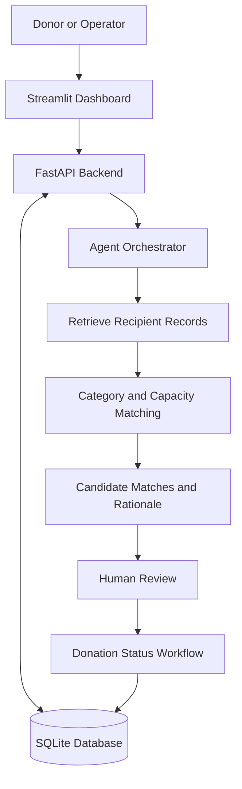

# FoodLoop AI
### Autonomous Food Rescue and Redistribution Agent

FoodLoop AI is a hackathon prototype that helps coordinate surplus-food donations with recipient organisations in Kokrajhar, Assam.

It provides a dashboard to record donations, register recipients, evaluate potential matches and track donation status while keeping food-safety checks and final decisions under human review.

## The Problem

Surplus food may go unused while community organisations need food resources. Donors and recipients need a way to coordinate food categories, quantities, recipient capacity and pickup timing.

## Our Solution

FoodLoop AI brings donation records, recipient information, explainable matching and workflow tracking into one dashboard.

## Features

- **Donation management:** Record food name, quantity, category, location and timing.
- **Recipient registration:** Store accepted food categories and declared capacity.
- **Explainable matching:** Evaluate potential recipients using deterministic rules.
- **Match rationale:** Show reasons candidates are eligible or rejected.
- **Status workflow:** Track donations through validated status transitions.
- **Agent decision logs:** Record matching decisions and tool traces.
- **Human oversight:** Keep safety verification and recipient confirmation under human review.
- **Persistent storage:** Store application records in SQLite.

## Architecture



The matching process is rule-based. The agent orchestrates application logic and records decisions; it does not independently certify food safety or confirm real-world delivery.

## Technology Stack

| Component | Technology |
|---|---|
| Frontend | Streamlit |
| Backend API | FastAPI |
| Data validation | Pydantic |
| Database | SQLite |
| Automated tests | Pytest |
| Language | Python |

## Project Structure

```text
FoodLoopAI/
├── backend/
│   ├── agent.py
│   ├── database.py
│   ├── main.py
│   ├── matching.py
│   └── schemas.py
├── docs/
├── frontend/
│   └── app.py
├── tests/
│   ├── test_smoke.py
│   └── test_status_workflow.py
├── .gitignore
├── README.md
└── requirements.txt
```

## Run Locally

### 1. Set up the environment

Run these commands from the project directory in PowerShell:

```powershell
python -m venv .venv
.\.venv\Scripts\Activate.ps1
pip install -r requirements.txt
```

### 2. Start the backend

Open a terminal in the project directory:

```powershell
python -m uvicorn backend.main:app --host 127.0.0.1 --port 8000
```

- Health check: http://127.0.0.1:8000/health
- Interactive API documentation: http://127.0.0.1:8000/docs

### 3. Start the frontend

Open a second terminal in the same project directory and activate the environment if needed:

```powershell
.\.venv\Scripts\Activate.ps1
python -m streamlit run frontend/app.py
```

Open http://localhost:8501 in your browser.

## Run Tests

From the project directory with the virtual environment activated:

```powershell
python -m pytest -v
```

The test suite covers application smoke checks, matching filters and key donation-status transitions.

## Safety and Limitations

- Matching is deterministic and rule-based; it is not an LLM-based autonomous decision system.
- A proposed match does not mean the recipient has accepted the donation.
- The application does not certify food safety.
- Human verification and recipient confirmation remain necessary.
- The prototype does not independently verify pickup, delivery or real-world partner participation.
- Matching uses declared categories and capacity; it does not establish travel distance or real-world suitability.

## Project Status

**Hackathon prototype.** Demonstration data and suggested matches must not be represented as verified operational outcomes.
